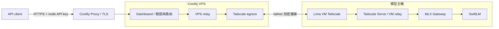

# Coolify + Tailscale：將本機模型提供成公開 API

此架構將公開入口放在 Coolify VPS，推理仍在本機完成。下圖的 VM 是網路與 relay 節點，不需要載入模型。



本部署使用 Coolify 既有 Traefik 處理 HTTPS，不必額外啟動 Caddy；Caddy 也可以擔任反向代理，但單純轉送不會取代 Dashboard 的 API key 驗證。其他平台或 Tailscale 版本的設定需重新驗證。

可調整的 Compose 範本位於 [`deploy/coolify/`](../deploy/coolify/)：VPS egress／relay、VM host relay 和 Dashboard。Dashboard 範本的相對 build context 適合本地 Compose；在 Coolify 的自訂 Compose 服務中需改成可存取的固定 Git build context。這些範本不含憑證，也不會自動設定 VM 的 Tailscale Serve、ACL 或管理 SSH bridge。

## 1. 準備與連線

1. 準備可管理 Docker 的 Coolify VPS、可指向 VPS 的 DNS 名稱，以及 TCP 80/443 的防火牆規則。Coolify 每個服務需設定正確的容器 port，並確認 TLS 憑證有效。
2. 在本機啟動推理服務與 Gateway，確保 Gateway 需要上游 key；模型的 loopback 位址不等於 VM 的 loopback，須確認 VM 可透過受保護的 host gateway 存取。
3. 建立獨立 Lima VM，安裝 Docker 與 Tailscale，將它和 VPS 的 Tailscale egress 加入同一個 tailnet。此部署採用 VPS 的 TUN 模式；不同環境若只支援 userspace，必須額外規劃 proxy，不可假設系統路由會自動生效。
4. 使用 VM 上的 Tailscale Serve 與只綁在 VM loopback 的 relay，轉送到主機 Gateway；在 VPS 建立只供內部 Docker 網路使用的 relay，讓 Dashboard 指向該 relay 的 `/v1`。兩端 Tailscale 網路和 port 應以 tailnet policy 限制，避免公開未驗證的 origin。
5. 若 Coolify 透過該 VM 的 SSH bridge 管理它，VPS egress 或 bridge 一旦停止，Coolify 也會失去 VM 管理連線。先保留 `limactl shell <vm>` 的復原方式，再操作 bridge。

例如，在已安裝 Lima 的 Mac 上建立新的 Docker VM：

```sh
limactl start --name=llm-relay --cpus=1 --memory=1 --disk=10 template:docker
limactl shell llm-relay
```

在 VM 內依所用 Linux 發行版安裝並啟動 Tailscale，透過 `tailscale up` 加入使用者自己的 tailnet；在 Coolify 加入該 VM 作為可管理的 server 前，需先配置並驗證 SSH。請保護具 sudo 權限的管理帳號與 key。將 VM relay 範本部署到該 VM，並依實際 Lima 網路設定 `MODEL_HOST_IP`；確認 relay 指向的 host gateway 不是 VM 本身的 loopback。在 VM 執行以下指令後，檢查 Serve 的狀態與 ACL：

```sh
sudo tailscale serve --bg --tcp=18124 tcp://localhost:18125
sudo tailscale serve status
tailscale status
```

再把 VPS relay 範本部署到 Coolify，設定 VM 的 tailnet IPv4 為 `TAILNET_TARGET_IP`。在 Coolify 中把 Dashboard 與 relay 接到同一個 Docker 網路，使用 Coolify 實際產生的 relay 容器名稱建立 `UPSTREAM_BASE_URL`。不要直接複用別台機器的 IP、SSH bridge 或秘密；最終連線必須實測。

## 2. 安全搬遷 Dashboard

Dashboard 使用 SQLite。先在來源建立 SQLite 一致性備份並驗證 `PRAGMA integrity_check`，再以完整雜湊檢查傳送後的備份，禁止只複製運作中的資料庫主檔而忽略 WAL。備份包含敏感資料，應限制讀寫權限、加密並保留可恢復副本。

在目標建立 `/data` 持久儲存，再匯入備份。保留原先 `KEY_HASH_SECRET` 才能驗證既有 client keys，也才能解密各節點已保存的上游憑證；保留 `SESSION_SECRET` 和管理員密碼以維持管理設定。憑證只能放在 Coolify secret 環境變數中，不可提交到 Git、印到 log 或傳給 client。預設節點的 `DEFAULT_NODE_ID` 必須維持舊值，避免既有資料和 key 指向錯誤節點；`UPSTREAM_BASE_URL` 指向新的私有 relay。

在切換以前先比較來源與備份的資料，並在必要時協調短暫停止舊端寫入、做最後一次同步。舊端持續寫入時，初次備份只代表某一時間點；新舊兩端不可長期當成同一份同步資料庫使用。保留來源與備份作為回復手段，不要在驗證前刪除。

## 3. 對外 API

Dashboard 保留 `/v1`；也可針對特定機器使用 `/nodes/<node-id>/v1`。管理介面的機器頁顯示對應 Base URL。`DEFAULT_NODE_ROUTE_ALIAS` 可替預設節點設定易讀別名，不會改動其資料庫 ID。各 key 只可存取所屬節點與其登記的模型；單節點多模型使用 JSON 的 `model` 欄位指定。

```sh
curl -N "$API_BASE_URL/chat/completions" \
  -H "Authorization: Bearer $DASHBOARD_API_KEY" \
  -H 'Content-Type: application/json' \
  -d '{"model":"YOUR_MODEL_ID","messages":[{"role":"user","content":"你好"}],"stream":true,"max_tokens":128}'
```

`API_BASE_URL` 例如 `https://YOUR_DOMAIN/nodes/mac-mini/v1`。不要把 key 寫入 Git、文件或公開 log。此版本的節點路由支援 `/models` 與 `/chat/completions`，不是所有 OpenAI API 端點。

## 4. 驗證與新增節點

- 檢查 DNS、有效的 TLS、Dashboard health、管理員登入與資料數量；重啟服務後再次檢查資料仍存在。
- 測試無 key／錯誤 key 為 401、其他節點的 key 為 403、正確 key 可列出模型和完成生成；以 `stream: true` 確認 SSE 區塊即時送達。
- 確認 tailnet 中斷、模型關閉、VM／VPS 重新啟動後的恢復方式，並保留離線錯誤而非繞過驗證。
- 新增機器時，為該機器建立自己的私有連線與受驗證上游，在 Dashboard 登記 origin、provider、模型和憑證，再發行綁定該節點的 client key。搬遷 Dashboard 不會自動搬走已登記的其他 Zeabur proxy，需逐台驗證與調整。

## 5. 延後搬遷：4090 與其他模型主機

以下是 2026-10-30 的現況紀錄，不是長期保證的位址，重新部署前應唯讀確認：

- Dashboard 的 `4090` 節點與原有 key 已搬到 Coolify；當時從新網域完成模型列表與推理測試，但節點的上游仍是 Zeabur `vllm-api-proxy`，並非已直接走新的 Tailscale。
- 該代理的 Caddy 設定中，`/svc-a` 指向 `192.168.1.79:8287`，`/svc-e` 指向 `192.168.1.79:5208`；另有 `/svc-b`、`/svc-c`、`/svc-d` 指向 `192.168.1.82` 的不同服務。這些是既有代理所見的私有網路位址，不能假設 Coolify VPS 或 Mac mini 可直接連到它們。
- 使用者確認 4090 在 `w79`；目前 Mac mini 無法解析這個 SSH 別名，使用者表示可能需要從 MacBook Air 登入。`192.168.1.82` 是另一台模型主機，其後續管理與遷移方式尚待確認。
- 先保留 Zeabur 代理和既有驗證，不要刪除或改寫；暫停搬遷這些主機不影響已完成的 Mac mini 路徑。若 Zeabur 代理離線，仍依賴它的模型會無法使用。
- 後續取得正確 SSH／跳板方式後，先確認各模型的實際 port、驗證、服務綁定位址及管理權限，再為每台主機建立受限制的 Tailscale 路徑。逐節點更新 Dashboard origin，實測既有 key、生成和串流，確認切換後再討論是否移除舊代理；不要記錄任何憑證。
